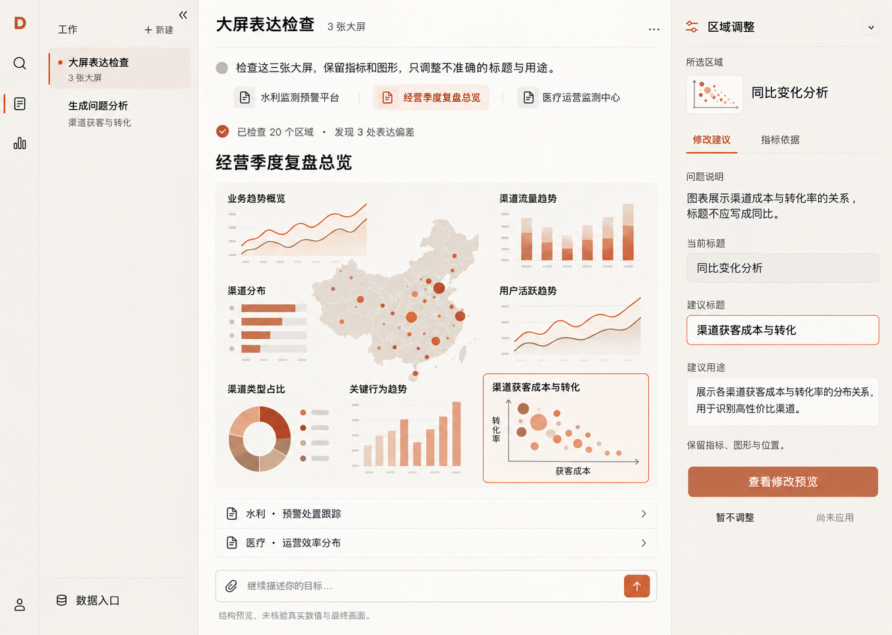

# 工作台 UI 改版：风格基准与设计目标

日期：风格基准 2026-10-26，最近整理 2026-10-29。状态：核心工作流及核心区适配已于 10 月 27 日发布；10 月 29 日的信息与文案收敛已完成本地验证，尚未发布。巡检及管理员页面整理仍待独立推进。

## 1. 已确定的方向

**暖白与陶土橙的可视化工作空间，保留动态左右侧栏。**

以用户认可的修订稿为视觉基准：保留第 1 版的可视化形态、会话结构与可展开收起的两侧工作区，采用 Claude 风格的暖中性色和陶土橙。不再沿用深色审阅文档的方向。

这张图用于确定布局、色系、密度与层次，不是已实现页面，也不是实际业务图表。图中的建议、图表数量与排列不能替代后端结果和源布局。

## 2. 产品目标

让用户在同一工作空间完成：**选定大屏与用途 → 定位有依据的问题 → 看清建议会改什么 → 预览 → 按权限逐项确认 → 复核结果。**

与 [D 阶段目标](../acceptance/d-operations-plan.md) 保持一致。交付价值是用户能够判断并完成具体改进，不以日志、节点数量、版本清单或控件数量衡量完成度。

本次 UI 目标：

| 目标 | 用户看到或能够完成的变化 | 验收依据 |
| --- | --- | --- |
| 看懂当前对象 | 明确当前大屏、选中区域、正在检查或修改的内容 | 切换大屏或区域后，画布、侧栏标题、依据、提案指向一致 |
| 在画布上定位问题 | 从建议定位到原区域，也能从区域查看相关建议 | 两条路径都可操作；不靠复制 ID 或重新提问连接上下文 |
| 判断建议是否值得采用 | 同时看到现状、改法、依据和保留内容 | 能说清“为什么改、改哪里、不改哪里”；证据不足明确可见 |
| 完成真实下一步 | 使用已有预览与确认流程，清楚区分未应用、准备中、失败、已保存 | 没有后端支持或授权时不显示可执行承诺；失败可定位并继续处理 |
| 保持工作连续性 | 收起侧栏扩大画布，展开后继续当前工作 | 折叠不清空选中对象、已输入内容或当前提案；恢复入口始终可见 |

## 3. 统一视觉规范

### 色彩

采用暖白基底、暖灰分区、深暖灰文字，陶土橙只强调选择、焦点与主要动作。以下是本产品拟采用的值，不作为 Claude 官方品牌色声明。

| 用途 | 设计值 | 使用规则 |
| --- | --- | --- |
| 主工作面 | `#FAF9F6` | 大面积阅读与画布外围 |
| 导航底色 | `#F2F0EB` | 左侧工具与会话区域 |
| 上下文底色 | `#F6F4EF` | 右侧工作区；与正文轻微区分 |
| 浮层与输入面 | `#FFFFFF` | 需要明确交互边界时使用 |
| 主文字 | `#302D29` | 标题、正文、重要数据 |
| 次文字 | `#756D64` | 说明、属性标签；不通过降低透明度削弱可读性 |
| 主要动作与链接 | `#B55235` | 白字按钮、可操作强调；比参考图橙色略深 |
| 装饰橙 | `#D97757` | 少量图标、大面积轻量强调；不承载白色小字 |
| 选中背景 | `#F4E4DA` | 当前会话、选中项与局部提示 |
| 分隔线 | `#E5E0D8` | 必要的结构边界；不用于逐项包框 |

色彩核对：`#B55235` 与白色的对比度约 4.97:1；`#D97757` 与白色约 3.12:1，因此不把浅橙直接用于普通字号白字按钮。实际组件还需检查 hover、disabled、focus 和背景组合。

错误、警告与成功继续使用独立语义色，配合文字与图标；不把所有状态都染成橙色。源大屏的真实配色与业务状态色保持原含义。仅平台自己生成的结构示意与分析图使用协调的暖色调色板，多个系列仍须可区分。

沿用 `globals.css` 的语义 token 与现有主题入口统一替换，不另建平行主题系统。浅色为本轮主验收基准；已有深色和跟随系统入口保留，调整后的主题不应出现冷蓝残留或文字失去对比度。深色使用暖炭灰与克制的橙色，不将主工作区变成嵌套黑色容器。

### 字体、密度与容器

- 沿用现有系统中文无衬线字体；不为视觉改版引入字体包。正文与控件 14–16px，辅助说明 12–13px，页面标题 22–26px。
- 用留白、标题、对齐、选中底色建立层次。使用 4/8px 间距步长，常见区域间隔 16/24/32px。
- 输入、菜单、按钮采用现有圆角尺度，以 6–8px 为主；不靠大圆角、阴影或渐变表现“高级”。
- 不把每个标题、段落、结果和列表项放进卡片。不出现“整页容器 → 分组容器 → 条目容器”的多层外框。
- 必须保留的边界：输入框、焦点、选中区域、必要表格对齐和弹层层次。去框不能损失交互可发现性。

## 4. 页面框架与动态侧栏

桌面结构为 **工具入口 / 会话导航 — 中央工作区 — 右侧上下文工作区**。工具入口与会话导航复用现有壳层，不要求无条件新增一套常驻导航。

### 左侧：去哪里工作

- 显示新建分析、当前会话和会话列表；数据与管理入口沿用现有权限与菜单。
- 保留现有折叠、宽度调整与 cookie 记忆。展开时可直接阅读会话名称，收起时保留必要入口和明确展开按钮。
- 不新增常驻的版本、目录、冻结集导航，也不按技术处理阶段组织用户主导航。

### 中央：当前正在处理什么

- 顶部只保留当前任务、对象范围和必要上下文；不重复放多层面包屑与状态栏。
- 可视化任务以画布为主体，对话用于说明目的、补充条件和继续推进；不能让长篇分析过程把画布推到页面底部。
- 结构图保持来源中的位置与比例；选中区域以轻量橙色标记、名称与焦点共同指示。
- 缺少布局、解析失败、没有业务数值时清楚说明真实限制；不能用参考图中的地图与图表补齐不存在的数据。
- 结构示意、修改预览、源系统实际画面使用明确名称。只有真实渲染的源画面才能作为实际效果证据。
- 画布可按容器等比适配；缩放、复位等控件只在当前渲染器确有需要时加入。首期不预建拖拽编辑器或无限画布。
- 查询、统计等任务沿用适合它们的列表、表格与图表，不强制所有回答都变成大屏画布。

### 右侧：对当前对象做什么

- 单一上下文面板集中展示当前对象的建议、指标依据与预览操作，避免同时打开多层详情。
- 从画布或建议定位到区域后展开对应内容；切换时同步对象名称、依据、修改范围和动作目标。
- 支持收起与明确恢复；收起只改变可见性，不应丢失当前编辑。离开带有未提交内容的对象时显式处理，不静默丢弃。
- 依据较多时在面板内按需展开，技术诊断独立折叠；不让原始 JSON 和内部 ID 成为主体。
- 每个操作阶段只有一个明显的主要动作，例如“查看修改预览”或“确认应用”；暂不调整等为次动作。后端未提供编辑能力时以只读解释替代假按钮。
- 预览与确认继续调用既有动作链路，不新增并行的保存状态或前端成功判定。

### 宽度与窄屏

- 1440px 参考预算：工具轨约 56px、会话区约 224px、右栏约 360px、中央约 800px；具体值以现有宽度约束和实际内容为准。
- 空间不足时先收起会话区，为中央画布保留可用宽度；不将中央内容挤成逐字换行。自动布局调整不能清空用户上下文。
- 右栏在宽屏并排占位，在窄屏沿用现有覆盖式详情模式。窄屏关闭后回到原选中区域和滚动位置。
- 侧栏开合不抢走用户正在阅读的焦点；键盘能展开、关闭、返回触发位置。动画克制，并尊重减少动态效果设置。

## 5. 内容取舍与流程呈现

| 内容 | 默认呈现方式 |
| --- | --- |
| 真实问题、影响对象、建议与下一步 | 主工作区摘要，具体操作进入上下文面板 |
| 当前执行进度 | 一段简短说明：正在检查什么、已有何种可用结果、是否需要用户补充 |
| 检查覆盖范围 | 真实读取范围与限制；未完整读取明确说明，不认证“全部通过” |
| 中间工具调用、节点完成、耗时 | 默认收起到分析过程；有失败或用户决策意义时主动呈现 |
| 版本、冻结集、内部编码、存储信息 | 来源与诊断按需展开；复制和排障能力保留 |
| 数据入口 | 用户能分析什么、如何进入分析、哪些数据缺失或影响当前任务 |
| 管理员接入页面 | 连接、采集与修复等实际操作；技术记录留在管理详情 |

中文业务描述优先；确有必要的源字段或错误码保留在详情中。空结果、证据不足、权限不足、解析失败与系统错误分别表达，不用统一“暂无数据”掩盖原因。

## 6. 现有实现与改动落点

以下为本轮只读核对到的现状，实施时沿用其边界：

| 文件 / 区域 | 当前可复用能力 | 改版落点 |
| --- | --- | --- |
| `src/app/globals.css` | 全局基础色与 shadcn 语义 token、日夜主题 | 将现有蓝色系映射到统一暖色系，检查引用它的管理与工作台页面 |
| `src/app/(workspace)/_components/workspace-shell.tsx` | 会话导航、折叠轨、宽度约束与 cookie | 风格与层次调整；复用折叠和宽度记忆 |
| `analysis-conversation-shell.tsx` | 消息轮次、选中对象、侧栏入口与追问 | 协调画布与侧栏上下文；保留既有执行与追问语义 |
| `analysis-side-panel.tsx` | 桌面内联、窄屏覆盖、Escape 关闭 | 统一右栏结构、恢复入口和操作组织 |
| `renderer/render-object-browser.tsx` | 来源结构、区域组件浏览、缺失与解析状态 | 复用真实结构画布；整合选中态和定位 |
| `renderer/block-improvement-panel.tsx` | 改进提案与既有动作入口 | 形成清晰的建议、依据、预览、确认层次 |
| `workspace/data` 与 `admin/ingestion` | 普通用户和管理员入口已分离 | 统一样式与中文内容，保持授权边界 |

分析组件路径均位于 `src/app/(workspace)/workspace/analysis/[sessionId]/_components/` 下。优先复用已有类型、renderer、状态和事件；没有真实重复实现时不新增“通用工作台引擎”、公共契约或后端字段。

## 7. 实施顺序与验收

### 第一批：外壳与主题

统一全局 token、工作台导航、左右栏、按钮、输入与状态样式。保留现有行为，不把“换橙色”视为整轮改版完成。

验收：两栏展开、只收左栏、只收右栏、两栏均收起都能工作；主题切换可读；1440×1024、1280×800 和窄屏无主体内容溢出或控件不可达。

### 第二批：可视化改进主流程

以“大屏表达检查”的已有会话与提案贯穿画布、区域定位、依据、预览、逐项确认和结果复核。移除重复正文与无价值完成陈述，保留实际错误和来源证据。

验收：从同一批对象选中大屏、定位建议区域、查看真实依据与前后内容；面板开合后继续同一工作；准备中、准备失败、权限不足与无足够依据都有清楚状态。源写回关闭时不冒充完成保存；真实保存与读回需要在已授权且已启用的环境单独验收。

### 第三批：相关页面统一与收尾

将已确定的风格扩展到首页、数据入口、巡检、管理接入和设置；按页面用途整理信息，不扩展本轮业务能力。

验收：相同按钮、输入、列表、选中与错误状态在各入口一致；普通用户看不到管理操作；技术来源仍可追溯；键盘焦点、长文本、空态和深色模式完成核对。

### 统一完成标准

- 交互核对：选中对象、滚动位置、提案上下文与动作目标一致；折叠后可恢复；主流程可用键盘完成。
- 视觉核对：以本文参考图与真实实现同尺寸对照，检查颜色、字级、密度、线框和两栏比例；源内容差异不以假图补齐。
- 工程核对：影响范围内的既有测试、TypeScript、相关 ESLint 与构建通过；只为真实新增行为补必要测试。
- 证据核对：分别记录设计完成、代码完成、本地快照验证、实际源保存及发布状态。设计稿不作功能验收，历史记录不作本轮执行证据。
- 本文确立 UI 目标，不替代 D 的后台能力与真实业务效果验收，不触发迁移、采集、数据同步或部署。

相关已有呈现改进见 [工作台回答与分析过程呈现](../acceptance/workspace-process-presentation.md)。既有去框与诊断保留的成果继续沿用。

## 8. 首轮实施记录（2026-10-26）

本轮范围：第一批外壳与主题，以及第二批的中央结构浏览和上下文入口。继续复用现有 renderer、对象读取、执行引用、查询草稿与改造动作契约，没有修改 Java、数据库、采集、源系统或部署配置。

### 已落地

- 全局浅色采用暖白、暖灰与陶土橙；深色采用暖炭灰与浅橙。导航选中态、输入焦点、用户消息和上下文面板统一使用既有 token，去掉首页输入面内外重复边框。
- 会话导航保留折叠、宽度与 cookie 记忆；不足 1200px 时默认显示 56px 图标栏，可手动展开。右栏从 1280px 起并排占 360px，更窄时覆盖显示。
- 大屏结构移到中央，在业务长回答之前呈现；同轮多个结构入口可切换，只挂载当前入口。非大屏记录继续使用详情入口，查询和统计保持原渲染方式。
- 点击原型区域或组件，同步中央选区和右栏的对象属性、组件依据与候选方案入口。切换当前画布、对象集合或筛选范围时清除旧上下文。
- 表格和图表中的正式改造提案均可打开右栏；继续使用原来的提案读取、准备、确认与恢复 API，展示真实动作状态和错误。右栏收起只隐藏，不卸载提案或查询编辑器；恢复入口始终可见。
- 窄屏打开右栏后限制 Tab 在面板内循环，Escape 收起，恢复后聚焦面板关闭按钮。查询编辑尚未提交而切换内容时显式确认；仅收起不清空草稿。

### 本地验证

环境：`local-dev`，Web 3000、Java 8080、平台本地快照。使用已有会话 `39342d21-5009-473e-9a33-fb01e8951718` 与普通业务账号，未发起新分析或源写入。

- `pnpm test:web`：195 项通过、5 项可选检查跳过。新增渲染回归核对中央画布先于正文、仅挂载当前画布，以及可视化提案保留上下文回调。原有用户消息测试改为检查消息组件语义，不再绑定旧的大圆角尺寸。
- TypeScript、改动文件 ESLint、生产构建和 `git diff --check` 通过。
- 浏览器核对 1440×1024、1280×800、390×844，无页面横向溢出；1024px 下自动缩为 56px 左栏。左右栏四种开合组合、选区与右栏同步、提案收起恢复、窄屏 Escape 与恢复焦点，以及浅色／深色切换均核对。
- 普通用户账户菜单没有管理操作，访问接入管理入口仍展示分析数据页。首页、数据入口和设置沿用统一主题；管理员操作页面未以管理员身份逐页验收。
- 已保存状态来自历史动作读回，不能视为本轮完成新保存。准备中、准备失败、无权限、冲突与恢复等沿用既有状态分支及契约测试；本轮未重新制造这些真实集成状态。查询草稿切换确认尚未在浏览器中单独演练。
- 截图保存在本地忽略目录 `.codex-runtime/workspace-redesign-20261026/`：`desktop-1440.png`、`desktop-1280.png`、`mobile-context.png`、`dark-1440.png`、`data-1440.png`。

### 后续批次边界

以下为首轮结束时的记录，后续完成情况以第 9 节为准。第二批当时仍未完成：当前画布仍属于对应对话轮次，没有独立固定的画布／对话分区；建议到原区域的双向定位、同批大屏与建议的统一切换及重复正文收敛仍待实施。关联应基于正式对象引用，不能靠标题相同推定目标。

第三批目前仅继承统一主题与首页输入样式，巡检、管理员接入与设置的逐页信息整理及完整键盘验收仍待进行。真实准备／保存、源画面复核与公司发布不在本轮执行范围，不能据此宣布整轮设计验收或发布完成。

## 9. 核心工作流实施计划（2026-10-26）

目标：将已完成的主题与结构浏览推进为与参考图一致的工作空间；本轮覆盖审查中已确认的核心缺口，不新增编辑业务、采集、迁移或公司部署。

| 顺序 | 实施内容 | 验收目标 | 状态 |
| --- | --- | --- | --- |
| 1 | 提案返回既有正式区域选择引用；统一动作读取与状态共享 | 建议按 objectKey/objectId 定位；无权限和错误可见，保存状态仅由原 API 驱动 | 已完成代码与本地核对 |
| 2 | 当前画布脱离历史消息流；建立任务标题、大屏切换与辅助对话 | 打开建议或查看历史时当前画布仍在；普通查询仍使用原消息与表格布局 | 已完成代码与本地核对 |
| 3 | 统一选区与追问范围；贯通区域→建议、建议→区域 | 切换水雨情监测后右栏、追问标签与目标一致；拒绝丢弃草稿时不切对象 | 已完成代码与本地核对 |
| 4 | 重排右栏为建议／依据；区分历史分析与当前动作状态 | 首屏说明问题、改动、保留内容和下一步；历史提案不冒充当前未应用 | 已完成代码与本地核对 |
| 5 | 收敛重复预览与正文，调整标题、输入区与导航层级 | 暖色风格和源比例保持；主要正文可读、默认输入紧凑；结构与修改预览一致 | 已完成代码与本地核对 |
| 6 | 契约、Java、Web 与实际浏览器验证 | 测试、类型、lint、构建通过；1440／1280／窄屏、开合、对象一致性及状态边界核对 | 已完成代码与本地核对 |

实现边界：新增提案区域引用有现成 UI 定位调用者，复用 ImprovementContext.selection；不新增并行保存流程。工作空间状态只用于页面呈现与既有追问，Java 继续重新校验对象、版本与权限。当前真实数值与未保留的源图形规格保持说明；主视觉展示补充见第 11 节，不补画业务数据；源写入不在本轮浏览器验证范围。每步完成后在此回填证据，不以计划替代验收。

### 核心工作流实施结果

- 当前画布独立于历史消息；任务标题、大屏切换、建议目录和紧凑追问常驻，历史对话按需展开。统计回答保留表格／图表与消息布局，点击对象入口后才进入画布，不因结果附带原型范围而自动切换。
- 画布选区、右栏对象和追问标签共用正式选择引用；建议目录能反向定位区域。修复了同一大屏内反向定位仍沿用旧局部选区的问题，并增加渲染回归。
- 右栏采用「修改建议／指标依据」，问题说明可展开，修改前后内容只读展示。预览复用源组件类型及相对布局，并明确标注示意、非真实业务数值；中央主视觉缺失不补造地图或数据。
- 历史对话与最近动作记录分别表达。既有保存状态由原动作 API 读回；本地未启用源写回时展示明确说明，不提供准备／确认承诺。面板收起保留提案和输入，恢复与窄屏 Escape 有可达焦点。
- Java 提案 View 返回 `ImprovementContext.selection` 和现有适配器配置状态 `executionAvailable`，前端有实际定位及操作可用性调用者。没有新增保存通道、迁移或配置开关，既有对象、版本与权限校验保持。发布时先更新 Java，再更新依赖这两个必填字段的 Web。

### 本地验证证据

环境：`local-dev`（Web 3000、Java 8080、本地平台快照）。使用普通业务账号及已有会话 `39342d21-5009-473e-9a33-fb01e8951718`；普通统计边界使用 `bd115d16-83d5-4a58-85f1-ff5b68d36cdc`。

- Web：205 项，200 通过、5 项可选检查跳过；覆盖正式提案引用契约、同标题对象不混用、独立画布、统计回答边界、全局选区与禁用写回操作。TypeScript、改动文件 ESLint、生产构建及 `git diff --check` 通过。
- Java：`EasyVBlockActionServiceTest` 10 项、`EasyVBlockActionDatabaseAdapterTest` 18 项全部通过；Java 打包通过。只读提案读取返回目标且不会调用准备或应用。
- 浏览器：1440×1024、1280×800、390×844；左右栏四种开合、浅／深色、窄屏关闭恢复焦点、对话展开仍保留画布均已核对，无页面横向溢出。原主题已恢复为系统设置。
- 点击「水雨情监测」同步右栏与追问；从建议目录打开「区域响应调度」后目标区域高亮、旧区域取消高亮。取消对象选择会清除选区；收起展开保留未发送的追问草稿（验证后已清空）。普通统计会话仍显示原消息、表格与图表，未自动挂载工作画布。
- 本轮截图：`.codex-runtime/workspace-core-20261026/desktop-1440.png`、`desktop-1280.png`、`mobile-proposal.png`、`mobile-canvas.png`、`dark-1440.png`。这些是本地实际页面，设计参考图不作为运行证据。

### 尚未覆盖的验收与后续范围

- 本轮没有发起新模型分析、准备／确认源保存、采集、迁移、公司部署；历史已保存记录不能作为本轮源写回成功证据。
- 查询编辑器的未提交草稿切换保护已实现，但已有主流程会话缺少对应编辑场景，尚未在浏览器中演练；不宣称完整键盘或无障碍验收。
- 第三批巡检、管理员接入与设置的信息整理仍待逐页实施；本轮完成的是已确认的核心工作流缺口，不能据此宣布整个设计规划全部验收。

## 10. 首页去重与提问入口（2026-10-26）

用户明确要求：首页分析记录与左侧重复，首页中央应更有设计感。

- 首页统一为「今天，想看清什么？」提问入口，不再因已有会话而退回记录列表。沿用暖白与陶土橙，以问候、字级、留白、轻量图形和输入面组织首屏，不增加数据卡片或虚构业务预览。
- 最近会话继续由左侧导航承载。完整搜索、状态筛选、分页和删除复用原 `WorkspaceSessionList`，移到个人记录页 `/workspace/history`，未转成管理员能力。展开侧栏的「全部记录」、折叠轨的历史图标，以及移动端账户菜单均有入口；空记录页可返回新分析。
- 仅在已授权 EasyV 能力可用时显示「先看看我的大屏」示例，其余示例来自后端能力列表；点击只填入并聚焦草稿，正式提交继续使用原 `/api/analysis/sessions`。去掉首页自动聚焦，避免初次打开即抢焦点或唤起移动端键盘。
- 本地浏览器核对：1440×1024 和 390×844、左右导航展开／折叠、浅／深色；窄屏无横向溢出。验证示例填入且未提交、历史搜索「雄安」得到 1 条、移动端记录入口可达；没有执行删除或新分析。主题恢复为跟随系统，侧栏恢复原收起偏好。
- Web 回归 200 项通过、5 项可选跳过；TypeScript、修改文件 ESLint、生产构建及 diff 格式检查通过。本轮无 Java、数据或发布改动。
- 实际页面截图：`.codex-runtime/workspace-home-20261026/desktop.png`、`mobile.png`、`dark.png`。

## 11. 主视觉展示（2026-10-26）

用户反馈：主视觉仅留白，未按图形规格形成有设计感的展示。复核发现，源 `pageSemantics.contents` 已保留标题、说明和指标；原前端只投影了 Content 外框，未接入这些语义。此前将留白归为「源主视觉缺失」不够准确，应区分文案、图形规格与真实渲染／数据。

- 复用已经授权读取的版式详情，按源 Page id 及 Content id/ref 唯一关联主视觉文案，不按同名或页面顺序猜关联。缺失、格式无效、重复及关联失败分别显示诊断，主视觉仍不生成虚构对象 ID。
- 已有水利、经营大屏的指标标识保留 `map-region/map-adcode/map-point` 规格，采用中性分区、点位、连线和空间层次展示地图构图。固定图形是样式样片，页面明确说明非真实地理与业务数据；不绘制或宣称实际行政边界、站点、风险等级或销售规模。
- 医疗主视觉源指标 id 为 null，仅保留三项指标文案；展示同一主视觉下的指标构成图，不根据标题或描述冒充识别出源图形规格。未提供可执行操作，不修改源主视觉。
- 保持源 Content 外框与区域比例、中央选区及原对象读取边界。小容器简化说明与指标图例，保留标题和主体图形；完整文案仍在版式「指标依据」可查。
- 本地快照浏览器：会话 `3f04ef14-f103-4e3d-b71e-e85b22395e57`，逐屏核对水利／经营／医疗标题及指标不串屏；1440×1024、390×844 及浅／深色核对，窄屏无页面横向溢出；已恢复原主题、侧栏及窗口尺寸。没有发起分析或源写回。
- Web：207 项，202 通过、5 可选跳过；覆盖页面／Content 引用关联、坏数据与重复记录拒绝误绑、地图规格识别和示意内容渲染。TypeScript、相关 ESLint、生产构建及 diff 检查通过。
- 截图：`.codex-runtime/workspace-mainvisual-20261026/desktop.png`、`mobile.png`、`medical.png`。本轮只改 Web 展示，无 Java、迁移或发布。

## 12. 新版核心指标区域（2026-10-27）

按用户要求观察源业务并适配新版 XML。核心区以 `type="core-metrics"` 容器和 `metric_role="core"` 区分于普通模块；支持五项小数跨度、fillLayout 主视觉叠放、正式角色入库／查询与核心块选中。源设计不要求普通模块方案 ID，不据此判断数据缺失。显式 Content 图形规格优先用于主视觉示意。

实现、验证和全量刷新边界见 [核心指标区域与全量数据刷新](../acceptance/easyv-core-metrics-refresh.md)。saas-test 七类源已全量重采并发布九个产品，公司与本地完成 V33，本地追加新快照且保留历史。银行驾驶舱在本地真实快照中验证了核心角色、指标单位口径、选中及追问；公司核对服务健康、版本和认证边界。最终 Web 已发布，fillLayout 主视觉前景避让顶部核心卡片，核心区不再显示普通模块方案入口。完整范围、对账及验证限制以该回执为准。

## 13. 信息与文案收敛（2026-10-29）

依据实际首页、核心指标、建议列表与窄屏审查执行四批收敛，详见 [实施计划及回执](./workspace-ui-improvement-plan-20261029.md)。移除首页口号及重复引导；单对象直接展示画布，无建议默认指标详情；正式对象读回后合并不同查询入口；最新建议与历史分组；指标单位、口径前置；去除虚拟数字；整理记录、折叠导航与设置。

本轮本地 Web 测试 204 通过、5 可选跳过，类型、相关 lint、生产构建及 diff 检查通过。1280×720、1440×1000 与 390×844 核对了画布、正式对象入口、核心指标来源、建议分组及窄屏焦点恢复。未重新分析、准备提案、写回业务源或发布公司服务。直接对象目录、真实主视觉渲染和后台逐页整理仍属后续独立范围。

## 14. 直接大屏目录与外围整理（2026-10-29 续）

2026-10-30 收尾：画布放大与比例切换、键盘区域列表、辅助图形配色、完整记录搜索、同题记录区分及后台响应式／中文标签已补齐。Web 208 通过、5 可选跳过；详见同一回执的“第三轮”。源业务实况渲染和完整无障碍认证不在完成声明内。

用户要求继续推进后，完成独立大屏目录 `/workspace/screens`：当前账号授权范围内直接搜索、打开结构、选择区域并读取核心／普通指标单位和口径，浏览不再占用分析会话或调用模型。新增只读目录 API 复用原权限、正式冻结版本与对象查询；分析入口原契约保持。现有画布和指标定义提取为共享组件，未建立另一套布局投影。

巡检将统计定义折叠并减少卡片层级；后台补本地环境标识，整理页头、导航、数据概况与空待办。经用户授权完成本地管理员只读检查，随后退出并恢复业务账号。Web 207 通过／5 可选跳过、Java 相关 48 项通过；类型、相关 lint、构建和桌面／移动检查通过。完整范围、证据及限制见 [第二轮回执](./workspace-ui-improvement-plan-20261029.md)。未发布公司服务，真实主视觉渲染仍待单独实现。
